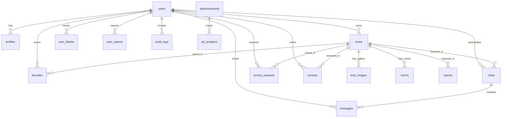

# CariKostKita — Database Architecture

**Provider:** Supabase PostgreSQL  
**Charset & Collation:** UTF-8  
**ORM:** Laravel 12 Eloquent  

---

## 1. Relational ERD Structure

---

## 2. Table Specifications

### 2.1 `users`
Akun terpadu untuk pencari kost, pemilik kost, administrator, dan moderator.
- `id` (bigint, PK)
- `name` (varchar 255)
- `email` (varchar 255, unique)
- `password` (varchar 255)
- `role` (varchar 50) — `pencari`, `pemilik`, `admin`, `moderator`
- `phone` / `no_hp` (varchar 20, nullable)
- `avatar` / `avatar_url` (varchar 2048, nullable)
- `bio` (text, nullable)
- `verification_status` (varchar 50) — `unverified`, `pending`, `verified`, `rejected`, `revision_required`
- `catatan_revisi` (text, nullable)
- `is_active` (boolean, default true)
- `ktp_path` (varchar 2048, nullable)
- `selfie_path` (varchar 2048, nullable)
- `kepemilikan_path` (varchar 2048, nullable)
- `pengajuan_at` (timestamp, nullable)
- `auth_provider` (varchar 50, default 'email')
- `google_id` (varchar 255, nullable)
- `timestamps`

### 2.2 `kosts`
Data utama properti kost yang melayani Mobile App, Admin-Gue, dan Landing Page.
- `id` (bigint, PK)
- `owner_id` (bigint, FK `users.id`, onDelete cascade)
- `name` / `nama_kost` (varchar 255)
- `description` (text, nullable)
- `address` (text)
- `patokan` (varchar 255, nullable)
- `no_whatsapp` (varchar 20, nullable)
- `province` (varchar 100, nullable)
- `city` (varchar 100) — Fokus: Pekanbaru
- `district` (varchar 100) — Kecamatan (Sukajadi, Tampan, Bukit Raya, dll.)
- `village` (varchar 100, nullable)
- `latitude` (decimal 10,8, nullable)
- `longitude` (decimal 11,8, nullable)
- `price_min` (decimal 12,2, default 0)
- `price_max` (decimal 12,2, default 0)
- `deposit` (decimal 12,2, default 0)
- `gender_type` (varchar 20) — `putra`, `putri`, `campur`
- `ukuran_kamar` (varchar 50, nullable)
- `total_kamar` (integer, default 1)
- `kamar_tersedia` (integer, default 1)
- `thumbnail_url` (varchar 2048, nullable)
- `image_urls` (json, nullable) — Array galeri gambar
- `facilities` / `fasilitas` (json, nullable) — Array fasilitas
- `aturan` (json, nullable) — Array peraturan sewa
- `rating_avg` (decimal 3,2, default 0.00)
- `rating_count` (integer, default 0)
- `views_count` (integer, default 0)
- `status` (varchar 50, default 'available') — `available`, `full`
- `verification_status` (varchar 50, default 'pending') — `pending`, `approved`, `rejected`
- `location_verification` (varchar 50, default 'UNVERIFIED')
- `catatan_revisi` (text, nullable)
- `timestamps`

### 2.3 `rooms`
Tipe spesifikasi kamar lanjutan per kost.
- `id` (bigint, PK)
- `kost_id` (bigint, FK `kosts.id`, onDelete cascade)
- `name` (varchar 255)
- `room_type` (varchar 100)
- `price` (decimal 12,2)
- `size` (varchar 50, nullable)
- `facilities` (json, nullable)
- `total_rooms` (integer, default 1)
- `available_rooms` (integer, default 1)
- `status` (varchar 50, default 'available')
- `timestamps`

### 2.4 `kost_images`
Berkas galeri foto kost.
- `id` (bigint, PK)
- `kost_id` (bigint, FK `kosts.id`, onDelete cascade)
- `file_path` (varchar 2048)
- `url` (varchar 2048)
- `is_primary` (boolean, default false)
- `timestamps`

### 2.5 `favorites`
Daftar simpanan kost pengguna.
- `id` (bigint, PK)
- `user_id` (bigint, FK `users.id`, onDelete cascade)
- `kost_id` (bigint, FK `kosts.id`, onDelete cascade)
- `timestamps`
- Unique: `(user_id, kost_id)`

### 2.6 `chats`
Ruang percakapan obrolan pencari dan pemilik kost.
- `id` (bigint, PK)
- `user_id` / `pencari_id` (bigint, FK `users.id`, onDelete cascade)
- `owner_id` (bigint, FK `users.id`, onDelete cascade)
- `kost_id` (bigint, FK `kosts.id`, nullable, onNullDelete)
- `last_message` (text, nullable)
- `last_message_at` (timestamp, nullable)
- `unread_count_user` (integer, default 0)
- `unread_count_owner` (integer, default 0)
- `timestamps`

### 2.7 `messages`
Pesan teks dalam ruang obrolan.
- `id` (bigint, PK)
- `chat_id` (bigint, FK `chats.id`, onDelete cascade)
- `sender_id` (bigint, FK `users.id`, onDelete cascade)
- `message` (text)
- `is_read` (boolean, default false)
- `timestamps`

### 2.8 `survey_requests`
Penjadwalan kunjungan/survei kost langsung.
- `id` (bigint, PK)
- `kost_id` (bigint, FK `kosts.id`, onDelete cascade)
- `pencari_id` (bigint, FK `users.id`, onDelete cascade)
- `owner_id` (bigint, FK `users.id`, onDelete cascade)
- `survey_date` (datetime)
- `status` (varchar 50, default 'PENDING') — `PENDING`, `CONFIRMED`, `REJECTED`, `COMPLETED`, `CANCELLED`
- `notes` (text, nullable)
- `owner_notes` (text, nullable)
- `timestamps`

### 2.9 `reviews`
Rating 1-5 bintang dan testimoni ulasan pengguna setelah survei selesai.
- `id` (bigint, PK)
- `kost_id` (bigint, FK `kosts.id`, onDelete cascade)
- `user_id` (bigint, FK `users.id`, onDelete cascade)
- `survey_request_id` (bigint, FK `survey_requests.id`, nullable, onNullDelete)
- `rating` (tinyint, 1-5)
- `comment` (text, nullable)
- `timestamps`
- Unique: `(kost_id, user_id)`

### 2.10 `user_blocks`
Daftar blokir antar pengguna.
- `id` (bigint, PK)
- `blocker_id` (bigint, FK `users.id`, onDelete cascade)
- `blocked_id` (bigint, FK `users.id`, onDelete cascade)
- `reason` (text, nullable)
- `timestamps`
- Unique: `(blocker_id, blocked_id)`

### 2.11 `user_reports`
Laporan pelanggaran pengguna/obrolan.
- `id` (bigint, PK)
- `reporter_id` (bigint, FK `users.id`, onDelete cascade)
- `reported_user_id` (bigint, FK `users.id`, onDelete cascade)
- `reason` (varchar 255)
- `details` (text, nullable)
- `status` (varchar 50, default 'Baru') — `Baru`, `Diproses`, `Selesai`, `Ditolak`
- `admin_notes` (text, nullable)
- `timestamps`

### 2.12 `reports`
Laporan data listing kost tidak valid/palsu.
- `id` (bigint, PK)
- `reporter_id` (bigint, FK `users.id`, onDelete cascade)
- `kost_id` (bigint, FK `kosts.id`, onDelete cascade)
- `reason` (varchar 255)
- `description` (text, nullable)
- `status` (varchar 50, default 'pending') — `pending` (Baru), `reviewed` (Diproses), `resolved` (Selesai)
- `timestamps`

### 2.13 `advertisements`
Materi promosi dan banner iklan untuk Mobile App.
- `id` (bigint, PK)
- `title` (varchar 255)
- `type` (varchar 50, default 'Banner') — `Banner`, `Pop-up`, `Promo Kost`
- `image_url` (varchar 2048)
- `target_url` (varchar 2048, nullable)
- `kost_id` (bigint, FK `kosts.id`, nullable, onNullDelete)
- `start_date` (date)
- `end_date` (date)
- `is_active` (boolean, default true)
- `impressions` (integer, default 0)
- `clicks` (integer, default 0)
- `timestamps`

### 2.14 `ad_analytics`
Rekaman event impresi dan klik iklan.
- `id` (bigint, PK)
- `advertisement_id` (bigint, FK `advertisements.id`, onDelete cascade)
- `event_type` (varchar 50) — `impression`, `click`
- `ip_address` (varchar 45, nullable)
- `user_agent` (text, nullable)
- `user_id` (bigint, FK `users.id`, nullable, onNullDelete)
- `created_at` (timestamp)

### 2.15 `application_releases`
Metadata rilis file biner APK Android untuk Landing Page dan pembaruan aplikasi.
- `id` (bigint, PK)
- `version_name` (varchar 50) — e.g. `v1.0.0-beta`
- `version_code` (integer) — e.g. `100`
- `apk_url` (varchar 2048)
- `file_size` (varchar 50, nullable)
- `min_android` (varchar 100, default 'Android 8.0 (Oreo)')
- `is_force_update` (boolean, default false)
- `is_latest` (boolean, default false)
- `changelog` (text, nullable)
- `release_date` (date)
- `download_count` (integer, default 0)
- `timestamps`

### 2.16 `platform_settings`
Konfigurasi dinamis sistem key-value.
- `id` (bigint, PK)
- `key` (varchar 255, unique)
- `value` (text, nullable)
- `type` (varchar 50, default 'string')
- `group` (varchar 50, default 'general')
- `description` (varchar 255, nullable)
- `timestamps`

### 2.17 `audit_logs`
Rekaman audit aktivitas admin untuk keamanan & kepatuhan.
- `id` (bigint, PK)
- `admin_id` (bigint, FK `users.id`, onDelete cascade)
- `action` (varchar 255)
- `target_type` (varchar 100, nullable)
- `target_id` (bigint, nullable)
- `details` (json, nullable)
- `ip_address` (varchar 45, nullable)
- `timestamps`

### 2.18 `crash_reports` & `app_events`
Telemetri crash aplikasi Android dan analitik produk (pencarian, view detail, survei).

---

## 3. Storage Buckets (Supabase Storage)

1. `kost-images` (Publik) — Galeri & thumbnail foto kost.
2. `ad-banners` (Publik) — Materi banner promosi.
3. `user-avatars` (Publik) — Foto profil pengguna.
4. `apk-releases` (Publik) — File installer APK Android.
5. `verification-docs` (Privat) — Berkas KTP, selfie, dokumen legalitas pemilik kost.
